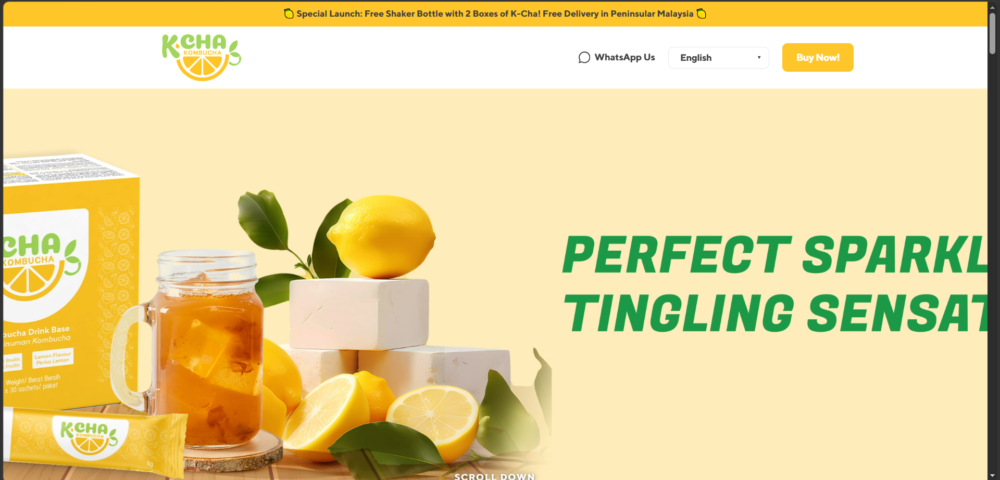
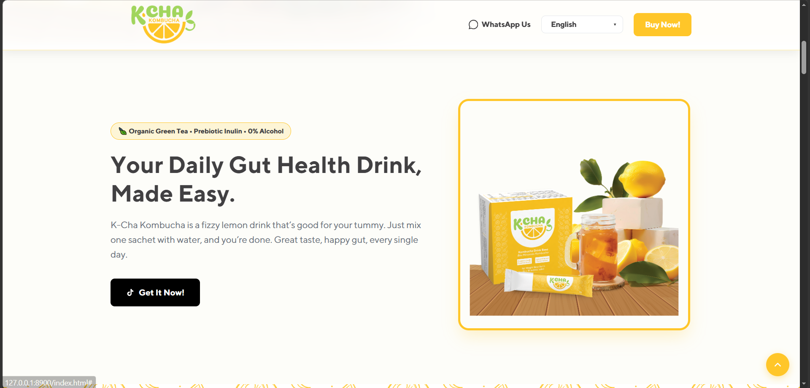
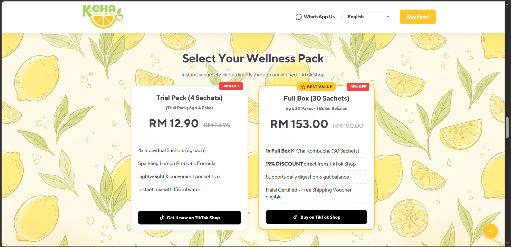

# K-Cha Kombucha — Official Product Landing Page

A responsive product landing page for **K-Cha Kombucha**, a fizzy lemon prebiotic kombucha drink by M-PLAN. Built with pure HTML, CSS, and JavaScript — no frameworks required.

---

## 🌐 Live Preview

> screenshots below ↓





---

## 📦 Features

- 🌍 **Bilingual Support** — English & Bahasa Malaysia toggle
- 📱 **Fully Responsive** — Mobile, tablet & desktop ready
- 🎬 **Auto-play Videos** — Scroll-triggered muted video playback
- 🍋 **Lemon Roll Animation** — Scroll-linked lemon spin effect
- 🎴 **Pop-out Product Animation** — Intersection Observer triggered
- ✨ **Scroll Reveal Cards** — Fade-in animation on scroll
- 🍔 **Mobile Hamburger Menu** — Slide-in navigation for mobile
- 🔝 **Back to Top Button** — Appears after scrolling
- 💬 **WhatsApp Float Button** — Mobile-only quick contact
- 🛒 **TikTok Shop Integration** — Direct purchase links
- 📜 **Smooth Scroll** — Anchor link navigation

---

## 🗂️ Project Structure

```
k-cha-landing/
│
├── index.html              # Main HTML file
├── style.css               # All styles & responsive breakpoints
├── script.js               # JavaScript interactions
│
├── Font/
│   ├── TTNorms-Regular.otf
│   └── TTNorms-Bold.otf
│
├── Pictures/
│   ├── logo.png
│   ├── Product.png
│   ├── K-Cha Box.png
│   ├── sachet.png
│   ├── lemon.png
│   ├── lemon.gif
│   ├── halal logo-01.png
│   ├── KKM logo-01.png
│   ├── GMP logo-01.png
│   ├── background2.png
│   ├── geminiback.jfif
│   ├── geminiback2.jfif
│   ├── kcha-outdoor-natural.jpg
│   └── K-cha background2.jfif
│
├── Vid/
│   ├── Kcha3.mp4
│   └── Kcha4.mp4
│
└── screenshot/
    ├── screenshot1.png
    ├── screenshot2.png
    └── screenshot3.png
```

---

## 🛠️ Built With

| Technology | Usage |
|------------|-------|
| HTML5 | Page structure & semantic markup |
| CSS3 | Styling, animations & responsive layout |
| JavaScript (Vanilla) | Interactivity, scroll effects & menu |
| Intersection Observer API | Scroll-triggered animations & video |
| CSS Custom Properties | Brand color tokens & theming |

---

## 🚀 Getting Started

No installation or build tools needed.

1. Clone the repository:
```bash
git clone https://github.com/YOUR-USERNAME/YOUR-REPO-NAME.git
```

2. Open `index.html` in your browser — that's it!

> ⚠️ For videos to autoplay correctly, serve via a local server rather than opening the file directly. Use VS Code's **Live Server** extension or:
```bash
npx serve .
```

---

## 📱 Responsive Breakpoints

| Breakpoint | Target |
|------------|--------|
| `> 992px` | Desktop |
| `≤ 820px` | Tablet |
| `≤ 640px` | Mobile |
| `≤ 480px` | Small Mobile |

---

## 🎨 Brand Colors

| Name | Hex |
|------|-----|
| K-Cha Yellow | `#FFC629` |
| K-Cha Green | `#A2D45E` |
| Charcoal | `#414042` |
| TikTok Black | `#000000` |
| WhatsApp Green | `#25D366` |

---

## 📋 Certifications Featured

- ✅ **KKM** — Kementerian Kesihatan Malaysia
- ✅ **GMP** — Good Manufacturing Practice
- ✅ **Halal** — JAKIM Certified

---

## 🛒 Purchase

Available exclusively on **TikTok Shop**:
👉 [Shop K-Cha Kombucha](https://vt.tiktok.com/ZS9yd7cJ3Vrcq-QupMj/)

---

## 📞 Contact

For enquiries, bulk orders or distributorship:

💬 [WhatsApp](https://wa.me/601120905342)

---

## 📄 License

This project is proprietary. All rights reserved © 2026 K-Cha Kombucha / M-PLAN.  
Unauthorized copying, distribution or reproduction is not permitted.
